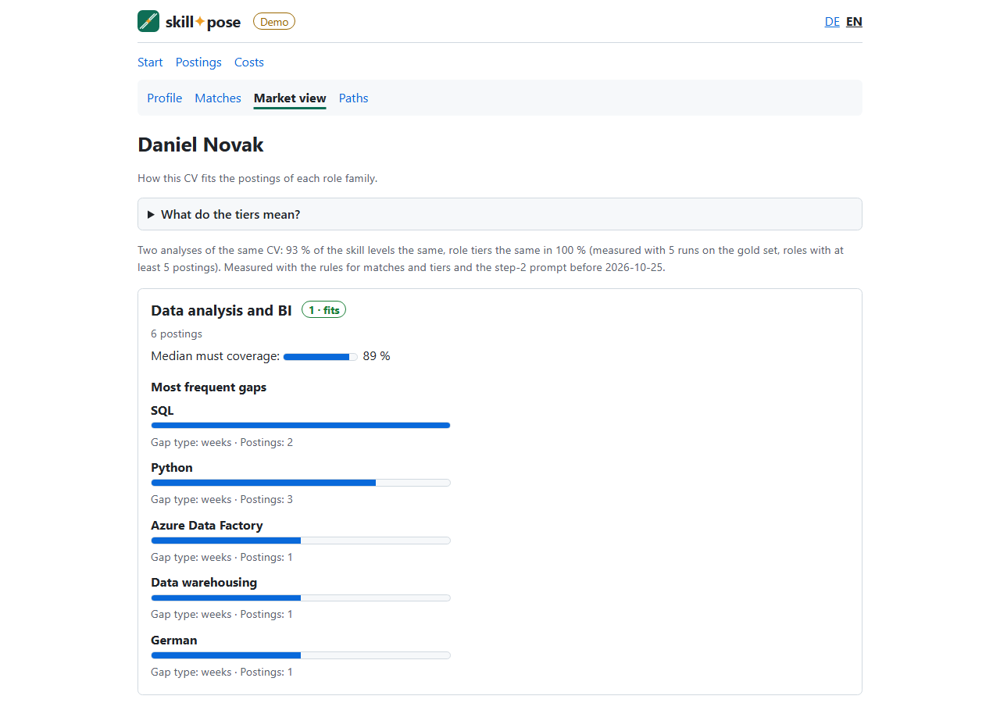
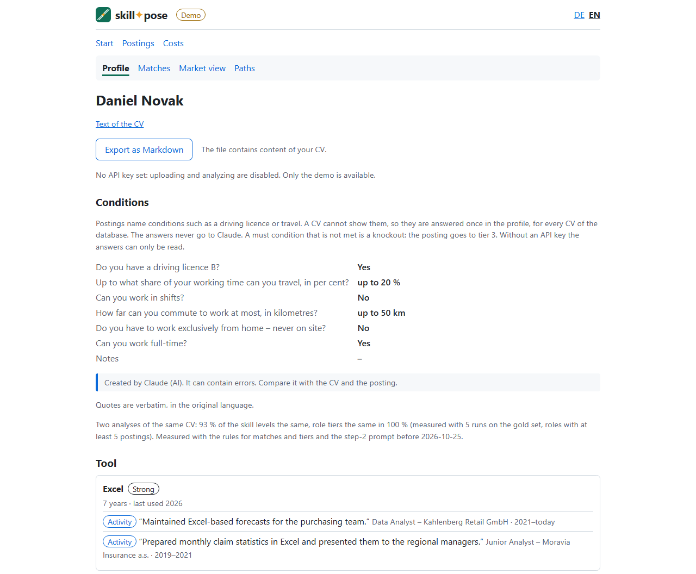
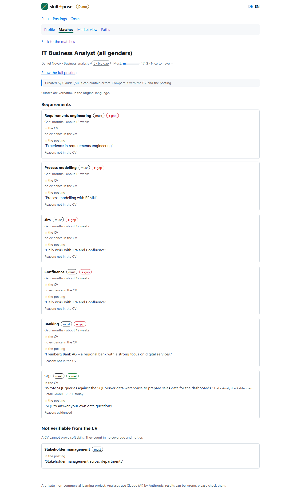
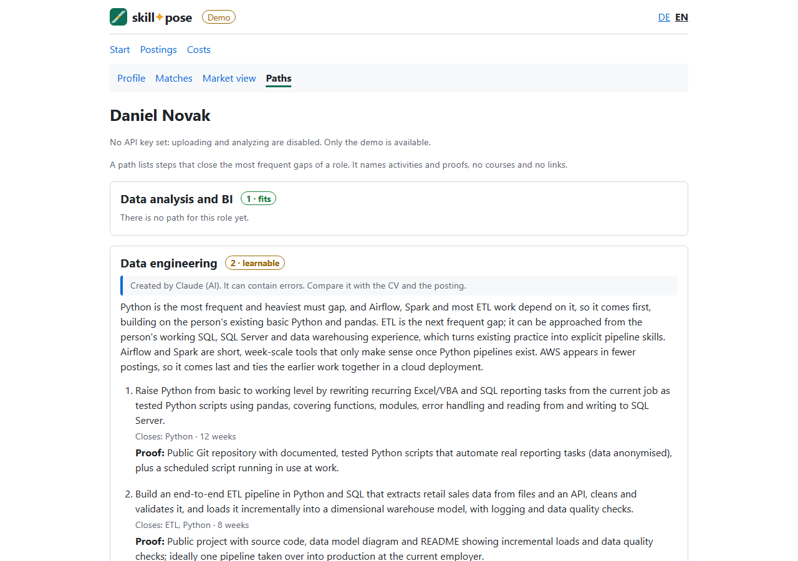
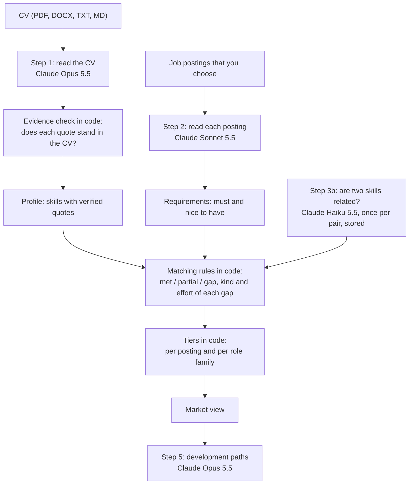

# skillpose


**Which jobs can your CV reach – and what is missing?** skillpose reads your own CV, proves every skill with a quote
from the CV, compares the skills with job postings that you choose and shows gaps, tiers and development paths.

**[▶ Try the live demo](https://hansczylok.github.io/skillpose/)** – three invented persons with finished results,
no installation, no API key. To run the app yourself, see the [Quick start](#quick-start).

A private, non-commercial learning project. It is not an offer of any kind, and there is no support. It is not
affiliated with or endorsed by Anthropic.

[](https://hansczylok.github.io/skillpose/)

Your skill pose: where you stand and which way to go. (In robotics, a pose is a position plus an orientation.)

## What it does

1. **Profile.** It reads a CV (PDF, DOCX, TXT or MD) and extracts skills with level, years and last use. Every skill
   carries a verbatim quote from the CV. The program checks that each quote really stands in the CV.
2. **Requirements.** It reads job postings (German or English) and extracts the must and nice-to-have requirements.
3. **Match.** Rules in code compare both: each requirement is *met*, *partial* or a *gap*, and each gap gets a kind
   (weeks, months, certificate, years of experience, degree) and an effort in weeks. A soft skill is listed apart as
   *not verifiable from the CV*. A condition of a posting (driving licence, travel, shift work, place of work, working
   time) is checked against answers that you give once in a form on the profile page. The page of a match shows three
   blocks: requirements, not verifiable, conditions.
4. **Market view.** Over many postings, each role family gets a tier, and each posting has its own tier in the match
   list. **1 is best.** The table says what the tiers mean in plain words, with the default settings; the exact rules
   are in [How it works](#how-it-works). The market view also lists the most frequent gaps.

   | Tier | Word | In plain words |
   |---|---|---|
   | 1 | fits | At least 80 % of the must requirements are met (partly met counts half); there is no gap in years of experience or degree and no must condition that your answers do not meet. |
   | 2 | learnable | No gap in years of experience or degree and no must condition that your answers do not meet, and all missing must requirements together can be learned in at most 26 weeks. |
   | 3 | big gap | Everything else, for example missing years of experience, a missing degree or more than 26 weeks of learning. |

5. **Development paths.** For a target role, Claude (Anthropic API) orders the most frequent gaps into at most 5 steps,
   each with an effort and a proof of the result, and explains the order. The paths page also lists the role
   families without a path, each with the reason (too few postings, no gaps, or the family "other").

## Screenshots

The demo person Daniel Novak (invented) with the English interface. The posting in the match view is in English; a
German posting of the demo is shown with its title and text translated into the language of the interface by Claude,
marked as such, with the requirements quoted verbatim in German. skillpose reads German and English texts. The profile
page shows the answers to the conditions of postings (invented, read-only in the demo), and the match page the block
"Not verifiable from the CV" for soft skills below the requirements.

| Profile: skills with verified quotes, and the answers to the conditions | Match: one posting, requirement by requirement, and the soft skill that a CV cannot prove |
|---|---|
|  |  |
| **Market view: tier and most frequent gaps per role family** | **Paths: steps with effort and proof for a target role** |
|  |  |

In the match screenshot, the must requirement "Banking" is a known extraction error: step 2 read the description of the
employer ("a regional bank") as a requirement. It is the one extra must requirement of this posting (12), which is why
its must precision is 0.86 in the [report](evals/results/2026-10-25-rules-and-step2.md).

## How it works



The language model reads text and writes the paths. Everything that decides a status, a tier or a number is code with
thresholds in [`defaults.yaml`](src/skillpose/core/defaults.yaml):

- **met:** the skill is in the CV, the level and the years are at least as required, the evidence is more than a
  mention, and the last use is at most 8 years ago.
- **partial:** the skill is there, but one condition is just missed (one level lower, fewer years, only named, older
  than 8 years), or a closely related skill is there.
- **gap:** otherwise.
- **Degrees:** a higher degree meets a lower one, and the field counts. Levels: 1 apprenticeship (or any "completed …
  training"), 2 HTL diploma or Matura, 3 bachelor, 4 master (Dipl.-Ing.), 5 doctorate. For a requirement of level 1 or
  2 the field is *technical* (engineering, electrical, mechatronics, computer science, HTL, IT), *business*
  (commercial, trade, accounting, finance, office, HAK) or the name of another field (physics); a requirement names
  one field, either of two ("commercial or technical training") or none ("completed training"). From level 3 the field
  is the suffix of the degree (engineering, computer science, business, physics …) and is compared as it stands: a
  master in engineering is another field than a bachelor in computer science. A degree of at least the required level
  in the same field meets the requirement, and with no field named any ranked degree does; from level 3 the degree
  must be higher (a master in engineering meets a bachelor in engineering). A **higher** degree in another field meets
  it only *partly*, because across fields the employer decides: a master in electrical engineering meets "completed
  technical training" and an HTL diploma, but "completed commercial training" only partly. That partial match has the
  reason "higher degree, other field" and no weeks of effort, so it lowers the coverage and never blocks tier 2. A
  degree of the same level in another field meets nothing by level, and a degree that names no field (doctorate,
  Matura) is no other field. A course has no level.
  Stored matches carry a fingerprint of the rules that made them; when rules or settings change, the app recomputes
  them at start (and `analyze` before it prints the market view), without an API call. `export` recomputes them in
  memory only and writes no match; a database file of an older layout is updated once when it is opened.
- **Soft skills and conditions:** a soft skill (communication, teamwork, …) is *not verifiable* from a CV. A condition
  of a posting (driving licence B, travel, shift work, place of work, working time) is checked against the user's
  answers, stored once per database: met, a gap, or *unanswered* while there is no answer. Neither is ever an effort;
  *not verifiable* and *unanswered* count in no coverage and no tier, and an unmet must condition is a knockout (a
  nice one never is). Step 2 marks them: a requirement of the kind *soft* is a trait of the person without a tool,
  method, degree or number of years ("experience in leading teams" is *experience*: a CV can show it); a requirement
  of the kind *condition* has its key (one of the five above, or none for another one such as "available at once") and
  the value the posting asks for ("30 %", "Linz", "full-time"). A check in code makes a skill of the category soft (in
  the vocabulary, or as Claude proposes a new one) a soft skill when step 2 gave it the kind tool, certificate, degree
  or spoken language; experience and conditions stay as step 2 gave them. You enter the answers in a form on the
  profile page (six fields and a note; the demo shows one invented set read-only, the same for all its persons). A
  save recomputes the matches of every CV without an API call. The page of a match shows three blocks: the
  requirements, the soft skills with the quote of the posting and no status colour, and the conditions (met, not met
  or unanswered, with the reason and a link to the form). The market view lists the must conditions that block
  postings apart from the gaps, and the Markdown export has a column "not verifiable" and a line for each blocking
  condition.
- **Tier of a posting:** must coverage = (met + 0.5 × partial) / number of must requirements. Tier 1: coverage at
  least 0.8, no must gap of the kind years or degree and no unmet must condition. Tier 2: no such gap either, and the
  efforts of all must requirements that are not met add up to at most 26 weeks. Tier 3: otherwise.
- **Tier of a role family:** the best tier (the lowest number) that at least 40 % of its postings reach; a family
  needs at least 1 posting (`min_jobs_per_role`; the minimum was 5 until October 2026, and some target roles have very
  few postings). With few postings a role tier rests on few postings: with one posting it is the tier of that posting,
  with two the better one. So the market view shows the number of postings of each role family.

## Intended purpose and limits

skillpose is for one person who checks **their own** CV against job postings that they select, to plan their own
career.

skillpose is **not** intended for employers, recruiters, staffing agencies, career services or public bodies, and not
for:

- recruiting, screening, filtering, ranking or evaluating candidates or employees,
- decisions about hiring, promotion, termination, pay or tasks,
- decisions about access to education or training.

These are high-risk uses under the EU AI Act (Regulation (EU) 2024/1689, Annex III points 3 and 4) and high-risk use
cases under Anthropic's Usage Policy. Whoever uses skillpose for them changes its intended purpose, takes on the
obligations of a provider of a high-risk AI system (Article 25(1)(c) AI Act) and must meet the data protection rules
for other people's data.

Results come from a language model (Claude) and from rules in code. They can be wrong or incomplete. Check every
skill against its quote from the CV before you rely on it. skillpose does not promise a job, a salary or a fit.

## Quick start

The demo needs no API key and makes no API call. It shows three invented persons (Maria Berger, Daniel Novak, Sabine
Huber) against 30 invented postings, with finished profiles, matches, market views and paths. The interface and the
development paths switch between German and English. Only in the demo, each posting is also shown in the language of
the interface as a translation by Claude (marked as such, the original one click away); quotes from the CVs and the
postings stay verbatim in their original language. Uploading and analyzing are locked in the demo.

A static copy of the demo needs no installation: it is at <https://hansczylok.github.io/skillpose/>. Build it yourself with `skillpose demo site --out site` (needs
`pip install ".[dev,web]"`) and open `site/index.html`.

### With Docker

Needs Docker with Docker Compose 2.24 or newer (`docker-compose.yml` uses the long form of `env_file`).

```bash
docker compose up
```

Then open http://127.0.0.1:8000. Without a `.env` file, or with an empty key, the app runs as the demo without a
password. In the container the app listens on 0.0.0.0, but compose publishes the port only on 127.0.0.1, so only your
own computer reaches it. The data is in the Docker volume `skillpose-data`.

### Without Docker

Needs Python 3.12: `pyproject.toml` allows only 3.12, so pip refuses an older or newer Python. `constraints.txt` pins
the tested version of every dependency (the Dockerfile uses it too).

Linux and macOS:

```bash
python3.12 -m venv .venv
source .venv/bin/activate
pip install -c constraints.txt -e ".[web]"
skillpose web
```

Windows (PowerShell or cmd; `py` is the Python launcher for Windows):

```bat
py -3.12 -m venv .venv
.venv\Scripts\activate
pip install -c constraints.txt -e ".[web]"
skillpose web
```

If `python3.12` or `py -3.12` is not found, install Python 3.12 first. On Debian and Ubuntu, `venv` also needs the
package `python3.12-venv`. If PowerShell refuses to run the activation script, run
`Set-ExecutionPolicy -Scope CurrentUser RemoteSigned` once, or use cmd, where `.venv\Scripts\activate` runs
`activate.bat`.

Then open http://127.0.0.1:8000. The app listens only on 127.0.0.1 and keeps its data in `data/skillpose.sqlite`
(relative to the folder where you start it).

## Using your own Anthropic API key

You need your own Anthropic API account. Anthropic's Commercial Terms and Usage Policy apply to it; check that your
use fits them (for example, the Commercial Terms say that the services are not for consumer use). Create a key only
for skillpose, set a spending limit in the Anthropic Console and never share or commit the key. skillpose's own
monthly limit (`MONTHLY_LIMIT_USD`) is a second guard, not a replacement.

Copy `.env.example` to `.env` and fill it in. `.env` is git-ignored.

| variable | meaning |
|---|---|
| `ANTHROPIC_API_KEY` | your key; empty = demo only |
| `MONTHLY_LIMIT_USD` | monthly limit in US dollars (default 5); it counts the costs of one database file (`eval`, `eval --repeat` and `demo build` have ledgers of their own); a run starts only if its estimate fits the rest (a task that waited in line checks again when it starts), and no new call starts once the limit is reached (step 3b runs up to 4 checks at once: up to 3 that are already under way then still finish and are booked) |
| `APP_PASSWORD` | password of the web app; required when the app listens on another address than 127.0.0.1 and a key is set |
| `SKILLPOSE_ALLOWED_HOSTS` | extra host names that the app accepts, separated by commas (for a reverse proxy); a wildcard (`*`, `*.example.org`) only with `APP_PASSWORD`, else the app refuses to start |
| `SKILLPOSE_PROMPTS` | folder with your own prompts (see [Prompts](#prompts)); empty = the example prompts |
| `SKILLPOSE_LOG` | the log file (see [Operation](#operation)); empty = `skillpose.log` next to the database, `off` = none |

- **Without Docker:** `skillpose web --env-file .env`. The app listens on 127.0.0.1, so it starts without a password
  (behind a reverse proxy, set one: see [Operation behind Caddy with HTTPS](#operation-behind-caddy-with-https)).
- **With Docker:** `docker compose up` reads `.env`. In the container the app listens on 0.0.0.0, so **with a key it
  needs `APP_PASSWORD`**. Without it, the app refuses to start and exits with code 2, and compose restarts it again and
  again (`restart: unless-stopped`); `docker compose logs` shows the reason. With a password, the browser asks for
  it; any user name works. A `SKILLPOSE_PROMPTS` folder that cannot be read ends the app with code 2 in the same way
  (see [Prompts](#prompts)); `docker-compose.yml` has a commented volume line that mounts a prompt folder read-only,
  and the matching setting is `SKILLPOSE_PROMPTS=/prompts` in `.env`.

Before a paid run the app shows the estimated cost; above 0.50 USD you must confirm (on the command line: `--yes`).
From 20 open postings, step 2 analyzes the first posting at once and sends the rest as three Message Batches at half
price: the first result is there after about a minute, each batch comes after minutes to hours. While the page
"Postings" is open, it checks the batches every 30 s, shows how far each one is and collects each batch as soon as it
has ended; after the browser was closed, the next visit does it. One paid task runs at a time, and the task line at
the top of each page shows how far it is (for example "Matching with the CV: 12 of 86 checked"). A task you start
meanwhile waits in line (up to five) and starts by itself; each task makes its plan only when it starts, so nothing
is paid twice, and it sends nothing if its estimate no longer fits the rest of the monthly limit then (the task line
says so). Stopping the app drops the waiting tasks. The page "Costs" shows the cost per step, the month
total, the rest up to the limit and the share of cache reads. With a key the app shows only your own data; without a
key, only the demo.

### Command line

```bash
skillpose analyze --cv my_cv.docx --jobs postings/ --lang en --env-file .env   # CV against a folder of postings
skillpose vocab --new                                                         # review skills that Claude proposed
skillpose eval --env-file .env                                                # paid: measure against the gold set
skillpose eval --repeat 4 --repeat-jobs 1 --env-file .env                     # paid: run-to-run variance
skillpose demo build --env-file .env                                          # paid: rebuild the demo data
skillpose demo site --out site                                                # free: the demo as static HTML
skillpose export --cv 1 --lang en --out data/analysis.md                      # free: the results as Markdown
```

`--jobs` takes `.md` and `.txt` files, folders, `.json` lists and `.csv` files with a text column. skillpose does not
fetch postings from web addresses. Run `eval` and `demo build` in the repository folder: they read `evals/goldset`.
The translations of the demo postings are files in [`evals/goldset/translations`](evals/goldset/translations/README.md);
`demo build` stores them and makes no API call for them.

**Export for a talk.** The profile page of a CV (also in the demo) has the button "Export as Markdown", and
`skillpose export` writes the same file; without `--cv` it takes every analyzed CV and adds a comparison, and `--out`
writes UTF-8 to a file. The file holds the skills with their strongest quotes, the market view, the match per posting
and the development paths, in German or English, with the tier words of the pages. It reads the stored results: no key,
no API call, no cost (it first recomputes matches that older rules made, in memory, and writes no match; a database
of an older layout is updated once when it is opened).
**The file contains content of your CV. Keep it private; do not publish it or commit it.** Git ignores the
folder `data/` and a downloaded export (`skillpose-*.md`) that lands in the repository folder.

## Eval results

Measured on 2026-10-25 on the gold set in [`evals/goldset`](evals/goldset): 3 invented CVs (German and English) and
30 invented postings, with the expected skills, requirements, statuses and tiers written by hand. Single calls,
prompt caching on. All measurements and the demo were made with the author's private prompts, not with the example
prompts of this repository (see [Prompts](#prompts)). Report:
[`2026-10-25-rules-and-step2.md`](evals/results/2026-10-25-rules-and-step2.md). The numbers were measured with the new
rules of matches and tiers (the degree ranking, the rules for soft skills and conditions) and the new step-2 prompt
(it marks soft skills and conditions). The earlier measurement of 2026-10-21 and 2026-10-22, made before these rules,
is the summary [`2026-10-phase2-summary.md`](evals/results/2026-10-phase2-summary.md); only the
[stability numbers](#stability) below are still from before 2026-10-25.

| step | model | measured | result |
|---|---|---|---|
| 1 CV → profile | Opus 5.5, effort medium | 3 CVs: recall of the expected skills, traps (skills a CV only plans to learn), evidence strength, verified quotes | recall 1.00, trap hits 0, strength 1.00, verified quotes 1.00 |
| 2 posting → requirements | Sonnet 5.5, effort low (default) | 30 postings: must recall / must precision | 1.00 / 0.99 |
| | Haiku 5.5, effort low (override) | same 30 postings | 0.99 / 0.99 (measured on 2026-10-21 with the earlier step-2 prompt; not run again) |
| 3 match status | rules + Haiku 5.5 for related skills | 34 single requirements with an expected status | 31 / 34 |
| 4 role tier | rules | 12 role families (3 persons × 4 families) | 12 / 12 (7 / 12 before the stricter step-3b prompt) |

- Step 2 in detail: on 2026-10-25 Sonnet 5.5 got role family, seniority, nice-to-have recall, must recall and the
  must/nice classification right in all 30 postings; it added a must requirement in 2 postings (precision 0.99). The
  comparison with Haiku 5.5 is from 2026-10-21 (earlier prompt; both models right on role family, seniority,
  nice-to-have recall and must/nice classification in all 30 postings): Sonnet 5.5 costs about 15 times as much as
  Haiku 5.5 (0.80 against 0.055 US cents per posting; on 2026-10-25 Sonnet 5.5 cost 0.81 US cents per posting).
  Sonnet 5.5 is the default by deliberate choice; Haiku 5.5 is the documented override for large runs on a small
  budget: `steps: {job: {model: claude-haiku-5-5}}` in a file for `--settings`.
- The first measurement (2026-10-21) gave only 7 of 12 role tiers: Haiku 5.5 rated many skill pairs as "close" that
  the reference table calls distant or unrelated (for example Power BI and SQL). After this first measurement the
  step-3b prompt was made stricter (2026-10-22: 12 of 12 tiers, 31 of 34 statuses; 12 reference pairs answered weaker,
  1 stronger). The run of 2026-10-25 reused these stored answers and asked only 7 new pairs; it gave the same 12 of 12
  tiers and 31 of 34 statuses. The three wrong statuses all come from relation answers (two answered weaker than the
  reference table, one stronger).
- **Honest limit:** the stricter prompt was written after seeing the failures on this same gold set. So 12 / 12 is a
  re-measurement on the data that the prompt was tuned on, not a held-out test. A held-out check needs new CVs and
  postings or a reference table by a second author.
- The gold set is small and invented, and its expected relations are one author's judgement. Real postings are
  messier.
- Phase 1 (15 postings) gave the same picture: Sonnet 5.5 must recall / precision 1.00 / 0.96 at 0.88 US cents per
  posting, Haiku 5.5 0.98 / 0.98 at 0.049 cents
  ([`2026-10-phase1-job-model.md`](evals/results/2026-10-phase1-job-model.md)).

## Stability

The same input does not always give the same result: Claude reads a CV or a posting a little differently each time.
`skillpose eval --repeat N` measures this run-to-run variance on the gold set. It makes N new runs of every CV, and
with `--repeat-jobs M` M new runs of the postings (as a batch), each with a new call. Then it compares all pairs of
runs of the same input and writes a report with the formula of each number. The new runs and their costs go to
`data/stability.sqlite`, a ledger of its own (the monthly limit counts only the costs of that file); the stored results
of `eval --save` stay as they are and count as the first run. The runs accumulate per configuration (prompt set,
model, effort and language): N and M are targets, so the same command again makes only the missing runs (after an
interruption it continues: nothing that was finished is paid twice, and a call interrupted mid-answer is paid once and
made again), and a larger N adds runs.

Measured in October 2026 with the author's private prompts (see [Prompts](#prompts)): each of the 3 CVs in 5
runs, the 30 postings in 2 runs; report: `evals/results/2026-10-stability.md`. "CV again" keeps the postings at
their first run, "postings again" keeps each CV at its first run.
The measurement ran with the earlier minimum of 5 postings per role, so the role tiers then covered only the role
families with at least 5 postings, and with the rules of matches and tiers and the step-2 prompt before 2026-10-25
(before the degree ranking, the rules for soft skills and conditions and the step-2 marking of them); the note in the
app says so too.

| compared between two runs | the same in |
|---|---|
| skills found (mean Jaccard of the two skill sets) | 95.9 % |
| level of a skill found in both runs | 93.2 % (at most one level apart: 100 %) |
| strongest evidence of a skill found in both runs | 94.8 % |
| requirements found in a posting (mean Jaccard) | 99.5 % |
| role family of a posting | 100 % |
| status of a requirement: CV again / postings again | 99.0 % / 99.5 % |
| tier of a posting: CV again / postings again | 99.6 % / 100 % |
| tier of a role family: CV again / postings again | 100 % / 100 % |
| heaviest gap of a role family: CV again / postings again | 100 % / 100 % |

What it means: single levels and single postings can change between two runs; role tiers and the main gaps are
stable in 264 of 264 cases. So read a single level or the tier of a single posting as a hint,
and the role tiers as the result. The profile page and the market view show the share of equal levels and of equal
role tiers in a note (the `stability` block of `defaults.yaml`).

**Honest limit:** the CVs of the gold set are short (one page). A longer, real two-page CV, analyzed twice, varied more:
about 88 % of the levels the same, 9 of about 75 differing. That CV is the author's own and the run is not
published (personal data), so there is no report for these two numbers. Expect more variation on long CVs than the table shows.

## Cost per analysis

One CV, 30 postings, the related-skill checks and 2 paths, from the cost ledger of the gold-set run of 2026-10-25
(prices of October 2026 in `defaults.yaml`; per analysis = mean of the three persons):

| step | model | per analysis | cache read share |
|---|---|---|---|
| 1 CV | Opus 5.5 | 0.119 USD | 32 % |
| 2 postings (30) | Sonnet 5.5 | 0.244 USD | 94 % |
| 3b related skills | Haiku 5.5 | 0.021 USD | 99 % |
| 5 paths (2) | Opus 5.5 | 0.050 USD | 45 % |
| **total** | | **≈ 0.43 USD** | |

Steps 1, 2 and 5 are from the run of 2026-10-25. Step 3b is from 2026-10-22, the run that asked all related-skill pairs
with the stricter prompt: the run of 2026-10-25 reused those answers and asked only 7 new pairs (0.002 USD in all).
The demo build of 2026-10-25 wrote each path in both languages (12 paths, 0.30 USD); the row counts 2 paths in one
language.

With step 2 in Message Batches (the default from 20 open postings: the first posting as a single call, the other 29
in three batches) it is ≈ 0.38 USD; with Haiku 5.5 for step 2 ≈ 0.20 USD (counted from the Haiku rows of 2026-10-21,
made with the earlier step-2 prompt; Haiku was not run again). The single call and each batch write the cached prefix
of step 2 once, so the first result at once costs ≈ 0.06 USD more than one batch of all 30 postings (≈ 0.31 USD). One
path costs about 2.5 US cents.

A long CV costs more: step 1 writes more output the longer the CV is, ≈ 0.40 USD for a two-page CV with many stations
(the estimate before an analysis follows the length of the CV).

These figures are a snapshot of October 2026 (the models and prices of that month). The app's "Costs" page shows the
average cost per call, measured in your own installation (with your own key). Prices change: check the current prices before a large run.

## Prompts

The prompts in this repository are simplified examples, under the MIT license like the code. They mark the input as
data and name every field of the answer, so that every step can run with them, but they leave out the rules that
were tuned by measurement. The measurements in [Eval results](#eval-results), the cost figures and the demo were
made with the author's private prompts, which are not published and not licensed. With the examples, expect weaker
results.

To use your own prompts, put four UTF-8 files in a folder: `cv.md` (step 1), `job.md` (step 2), `relation.md`
(step 3b) and `path.md` (step 5). Each file holds the system text of its step; the program adds the output language,
the vocabulary, the role families and the profile. Then set `SKILLPOSE_PROMPTS` to the folder (in the environment or
in the file for `--env-file`), or pass `--prompts FOLDER` to `analyze`, `eval`, `demo build` or `web`. With Docker,
mount the folder into the container and set `SKILLPOSE_PROMPTS` to its path there. If the folder cannot be read, the
command stops with exit code 2 and names the missing file; it never falls back to the examples. `analyze`, `eval`,
`demo build` and `web` print the prompt set that they use, the page "Costs" shows it for your own data, and the eval
report names it: `example`, or `private:` and the first 8 hex digits of a SHA-256 over the four texts.

## Design decisions

- **Rules in code, not a language model per pair.** One model call per pair of CV and posting would give no market
  view, cost a lot for many postings and be hard to check. Here the model reads each text once (a posting is stored
  by the hash of its text) and judges each pair of skills once (stored); statuses, gap kinds, weeks and tiers are
  rules in code with thresholds in YAML. The same profile and requirements always give the same statuses and tiers,
  and tests cover every rule.
- **Verified verbatim quotes instead of the Citations API.** Citations cannot be combined with structured output. So
  every skill comes with a quote, and the program looks for it in the CV text after normalization (case, white space,
  quotation marks, dashes): first as a substring, then by similarity (difflib, threshold 0.90). A quote that is not
  found gets `verified = false` and the strength "only named", and the page marks it.
- **Structured output.** Every answer follows a JSON schema made from a Pydantic model. The program books the cost
  first and validates the answer afterwards, so a truncated or invalid answer is paid for and visible in the ledger,
  and the entry stays open for a later run.
- **Prompt caching with a frozen prefix per run.** Only the last block of the fixed part carries `cache_control`. The
  fixed part holds no time stamps, no run ids and no unsorted JSON; each run works with a frozen, sorted snapshot of
  the vocabulary (333 seed skills), and new skills that Claude proposes are merged only after the run. Result: 94 %
  cache reads in step 2 and 99 % in step 3b.
- **Message Batches at half price, the first result at once.** A batch can take hours, so from 20 open postings the
  first one goes out as a single call and the rest as three batches (`batch_single_first` and `batch_groups` in
  `defaults.yaml`); the batches are submitted first, so their clock starts. Results are matched by `custom_id`, never
  by order. Each batch is collected on its own as soon as it has ended. If the browser closes or the server restarts,
  the next visit collects them, and nothing is paid twice.
- **Related-skill checks in parallel.** Thirty postings can need 80 and more checks of step 3b. Up to four run at
  the same time (`relation_workers` in `defaults.yaml`; 1 = one after the other): the first alone, so that it writes
  the cache, then the rest. Only the requests run in other threads; every answer is booked and stored in the order of
  the skills, so the result is the same as one check after the other.
- **Cost ledger and monthly limit.** Every call is booked with its tokens, cache writes and reads and its price. A
  run starts only if its estimate fits the rest of the monthly limit (in the web app checked at the click and again
  when the task starts, after the tasks before it in line), and no new call starts once the limit is reached; a
  single answer can still cost more than estimated, and up to `relation_workers` - 1 checks of step 3b may already
  be under way when the limit is reached (they finish and are booked). The app asks for confirmation above 0.50 USD.
- **Demo mode.** Without a key the app serves finished results of the gold set from packaged data, so a pip install
  has the demo too. Every writing route is locked in the demo, and a test checks all of them. With a key the app shows
  only your own data: no demo and no switch between the two.
- **Stricter relation prompt after measurement.** See [Eval results](#eval-results): the prompt was changed because of
  a measurement, and the README says what that means for the result. The tuned prompts are private; the repository
  ships simplified examples (see [Prompts](#prompts)).
- **Untrusted text stays data.** CV and posting go to the model only inside marked sections, and a closing tag in the
  text cannot end its section early. The web app sends a strict Content Security Policy, refuses requests from other
  sites (Origin and `Sec-Fetch-Site`) and unknown host names (DNS rebinding) and accepts uploads of at most 5 MB.
- **AI label.** Pages with model output (profile, requirements of a match, paths) say that Claude created them and
  carry the attribute `data-ai-generated`.

## Operation

The commands `web`, `analyze`, `eval` and `demo build` write a log file: `skillpose.log` in the folder of the database
(`--db`; by default `data/skillpose.log`, with Docker `/data/skillpose.log` in the volume). At 1 MB it moves to
`skillpose.log.1`, and three old files are kept, so the log takes at most about 4 MB.

- **In it:** the start, end, duration and result of each task; one line per API call (step, model, input, output and
  cache tokens, US dollars, duration, single call or batch; a batch result has no duration of its own, so its line
  names how long the whole batch took); each batch submitted and collected (batch id, counts); errors with their
  traceback. An uploaded file that cannot be read, and a command that stops with an error, get only the kind of error,
  as the message of a parser may quote the file; the console shows such a command's error in full.
- **Never in it:** the text of a CV or a posting, quotes, prompts, the API key, `APP_PASSWORD`, the names and paths of
  uploaded files. It names ids, hashes and counts, and error texts of the Anthropic API as they come (they hold no
  text from a CV or a posting). In an error, the file it names shows only its type (`<file>.pdf`), and everywhere the
  home folder shows as `~` and the temporary folder as `<tmp>`, also where an error message writes them with doubled
  backslashes or, on Windows, in another case.
- **Elsewhere or off:** `--log-file PATH` or `SKILLPOSE_LOG=PATH` (also in `.env`) writes it elsewhere, `--log-file
  off` or `SKILLPOSE_LOG=off` switches it off. The console shows warnings and errors only, as before.

## Operation behind Caddy with HTTPS

To reach your own installation from another device, put it behind a reverse proxy with TLS, for example
[Caddy](https://caddyserver.com) on the same machine:

```
skillpose.example.org {
    reverse_proxy 127.0.0.1:8000
}
```

```bash
# .env (no comments after a value: they would become part of it)
ANTHROPIC_API_KEY=...
APP_PASSWORD=...
SKILLPOSE_ALLOWED_HOSTS=skillpose.example.org
```

- Make skillpose reachable only through HTTPS. `APP_PASSWORD` uses HTTP Basic authentication, which sends the
  password with every request; without TLS, anybody on the way can read it.
- Use a long random password. Put the public host name into `SKILLPOSE_ALLOWED_HOSTS`. Name each host: a wildcard
  lets any host name pass the check against DNS rebinding, so the app accepts it only with `APP_PASSWORD`.
- Keep the container port on 127.0.0.1 (as in `docker-compose.yml`), so that only Caddy reaches it.

Set `APP_PASSWORD` behind a proxy also without Docker: an app on 127.0.0.1 cannot tell that Caddy forwards requests
from the internet, so it refuses to start without a password only when it listens on another address. Once
`APP_PASSWORD` is set, the password is checked on every request, whatever the address.

## Data protection

- skillpose runs on your computer. It keeps your data in one SQLite file (by default `data/skillpose.sqlite`; with
  Docker in the volume `skillpose-data`).
- It keeps the text of your CV, not the file. It does not read images in a PDF or DOCX, such as a photo.
- It writes a log file next to the database (`skillpose.log`, at most about 4 MB) with what it did: tasks, API calls
  and their cost, batches, errors. The log holds no CV or posting text, no quotes, prompts, keys or passwords, no
  file names of uploads or of a CV, and no user name from the home folder; `SKILLPOSE_LOG=off` switches it off (see
  [Operation](#operation)).
- Only one data flow leaves your computer: the CV text and the posting texts go to the Anthropic API, with your own
  API key. Your contract for this is with Anthropic (Commercial Terms; in the EEA with Anthropic Ireland, Limited).
  Anthropic, PBC is a US company. Anthropic's Data Processing Addendum uses the EU Standard Contractual Clauses.
- Anthropic's current terms say: no training on API data by default; inputs and outputs are deleted within 30 days,
  or kept longer (up to 2 years) when flagged under the Usage Policy; batch results stay available for 29 days. Check
  the current terms: https://www.anthropic.com/legal/commercial-terms and
  https://privacy.claude.com/en/articles/7996866-how-long-does-anthropic-store-my-organizations-data
- skillpose sends no telemetry and loads no fonts, scripts or images from other sites. The Anthropic SDK sends
  technical headers with each request (SDK version, operating system, architecture).
- One cookie: `lang` (language of the interface). It is set only when you click, is HTTP-only and lasts one year.
  There is no tracking.
- Before you analyse a CV, remove what the analysis does not need: address, phone, date of birth, family status,
  religion, health or disability information. skillpose needs only experience, education and skills.
- "Delete" in the list of CVs on the start page, or "Delete this CV" at the bottom of a CV page, removes the CV with
  its profile, matches and paths. Postings stay. Data that was already sent to Anthropic is deleted by Anthropic under
  its terms. To remove everything, stop skillpose and delete the SQLite file,
  its backups and the log files (with Docker: `docker compose down -v` removes the volume).
- If you process other people's CVs, the GDPR applies to you as the controller: you need a legal basis, you must
  inform the persons and you must check the transfer to the USA. See
  [Intended purpose and limits](#intended-purpose-and-limits).

## Known limits

- The gold set has 3 CVs and 30 postings, all invented; the 12 / 12 role tiers are not a held-out result (see [Eval
  results](#eval-results)). The thresholds sit inside the window where all 12 tiers hold; one of them
  (`role_tier_share`) at its upper edge. The gold-set numbers were measured on 2026-10-25 with the new rules of
  matches and tiers and the new step-2 prompt; the stability numbers were measured before 2026-10-25.
- The place of work of a posting is checked without a distance: only the answer "I have to work exclusively from
  home" rules a posting out. The commute in kilometres is stored and shown, but not compared with the place of the
  posting.
- A role tier can rest on one or two postings (the minimum is 1 posting per role family). The market view shows the
  number of postings of each role family; read such a tier as a hint.
- Input is text or files only; there is no fetching from portals or web addresses.
- A very long CV can still hit the token limit of step 1 (32,000 output tokens; the model's thinking counts too, and a
  CV of about 9,000 characters used close to 16,000). The answer is then cut off and gives no profile; the message says
  so and names the cost of the attempt, which is paid and booked. Try again or shorten the CV; `--settings` can raise
  `steps.cv.max_tokens` up to 64,000 (every single call is streamed, so the SDK allows it).
- A streamed answer can break off (lost connection, or an error such as overload during the answer). It gives no
  result, but it is paid: the ledger books the input and cache tokens that the API reported at the start; the output
  up to the break is not reported, so for such an attempt the ledger can show less than Anthropic bills.
- German and English CVs and postings; the interface is German or English. A development path is made in the
  language of the interface (the demo has each path in both); quotes and posting texts stay in their original
  language (only the demo shows its postings translated as well).
- Postings cannot be deleted in the app; only a CV with its profile, matches and paths.
- Stored profiles, requirements and relations are not keyed by the prompt set (only development paths are): after a
  change of prompts, delete the database file (or use a new one with `--db`) and analyze again to compare.
- The API keeps the results of a Message Batch for 29 days. A batch that is not collected in that time, or that the
  key cannot see (another key or workspace), is given up: its postings are open again, with the reason, and the next
  analysis sends them again. What such a batch cost does not reach the cost ledger.
- Skills outside the vocabulary are proposals until you review them (`skillpose vocab --new`). There is no mapping to
  ESCO yet.
- One user, no accounts. skillpose is designed to run on 127.0.0.1 (see [SECURITY.md](SECURITY.md)).

## Development

```bash
pip install -c constraints.txt -e ".[dev,web]"
python -m pytest -q                 # no API call; the live tests are deselected by default
python -m ruff check src tests
```

The CI (GitHub Actions) runs ruff, pytest and a Docker build without an API key.

## License

MIT, see [LICENSE](LICENSE); the name and the logo are excluded, see [Name and logo](#name-and-logo).

skillpose uses third-party packages under their own licences (MIT, BSD-2-Clause, BSD-3-Clause, Apache-2.0, PSF-2.0,
MPL-2.0); pip installs each package with its licence file. An image that you build from the Dockerfile contains
Debian and Python packages under their own licences. This repository publishes no prebuilt image.

"Claude", "Claude Code" and "Anthropic" are trademarks of Anthropic, PBC. skillpose uses them only to name the API
that it calls and the tool that the code was written with.

### Name and logo

The MIT license covers the code and the documentation. The name "skillpose", the wordmark (also its inline copy in
the page templates) and the logo and icon (also where screenshots show them) are not licensed under it: © 2026 Hans
Czylok, all rights reserved. A fork may use the code, but not the name, the logo or the icon.
The logo files are `src/skillpose/web/static/logo.svg`, `icon.svg`, `favicon.svg`, `apple-touch-icon.png` and
`docs/img/logo.svg`.

## Author

Hans Czylok, Austria. Idea, concept and requirements: Hans Czylok. The code was written with Claude Code
(Anthropic) under his direction; he checked and accepted it. Built as a private learning project.

## Kurzfassung (Deutsch)

skillpose liest den eigenen Lebenslauf und findet die Kompetenzen, die er mit wörtlichen Zitaten belegt. Es vergleicht
sie mit selbst gewählten Stelleninseraten und zeigt Lücken, eine Stufe je Rollenfamilie und Entwicklungspfade. Stufe 1
passt, 2 heißt Lücken lernbar, 3 große Lücke. Der Name:
„Pose“ wie in der Robotik – Position und Orientierung, also wo man steht und wohin man geht. Es ist ein privates,
nicht-kommerzielles Lernprojekt ohne Angebot und ohne Support; es ist nicht mit Anthropic verbunden. Es dient nur der
Prüfung des eigenen Lebenslaufs, nicht der Auswahl oder Bewertung von Bewerbern. Die Demo mit drei erfundenen Personen
braucht keinen Schlüssel und kostet nichts: `docker compose up` oder in einer venv mit Python 3.12
`pip install -c constraints.txt -e ".[web]"` und `skillpose web`, dann http://127.0.0.1:8000. Oberfläche und
Entwicklungspfade wechseln zwischen Deutsch und Englisch. Nur in der Demo erscheint jedes Inserat auch als Übersetzung
von Claude (KI) in der Sprache der Oberfläche, gekennzeichnet und mit dem Original; Zitate bleiben wörtlich in der
Originalsprache.
Mit einem eigenen Anthropic-Schlüssel zeigt und analysiert die App nur eigene Daten, ohne Demo; eine Monatsgrenze
(Vorgabe 5 USD) und eine Bestätigung ab 0,50 USD begrenzen die Kosten. Mit Docker und Schlüssel ist `APP_PASSWORD`
Pflicht, sonst startet die App nicht. Die Regeln für Abgleich und Stufen stehen im Code; Claude liest nur die Texte,
beurteilt verwandte Kompetenzen und schreibt die Pfade. Ein höherer Abschluss erfüllt einen niedrigeren (Lehre, HTL oder
Matura, Bachelor, Master, Doktorat), wenn das Fach passt; ein höherer Abschluss in einem anderen Fach (Master
Elektrotechnik, verlangt ist eine kaufmännische Ausbildung) erfüllt ihn nur teilweise. Soft Skills gelten als aus dem
Lebenslauf nicht prüfbar und zählen nirgends mit; Rahmenbedingungen wie Führerschein oder Reisebereitschaft
beantwortest du einmal im Formular auf der Profilseite, und eine Muss-Bedingung, die du nicht erfüllst, setzt ein
Inserat auf Stufe 3. Im Goldsatz stimmen 31 von 34 Abgleichen und 12 von 12 Stufen; die 12 von 12 sind eine
Nachmessung auf denselben Daten, nach denen der Prompt geschärft wurde.
Eine Rollen-Stufe gilt ab 1 Inserat je Rolle (Vorgabe, früher 5); bei wenigen Inseraten beruht sie auf wenig Daten,
darum zeigt die Marktsicht die Anzahl.
Die Zahlen des Goldsatzes wurden am 25.10.2026 mit den neuen Regeln für Abgleich und Stufen und dem neuen Prompt von
Schritt 2 gemessen; nur die Zahlen der Streuung entstanden davor, mit den Regeln und dem Prompt von Schritt 2 vor dem
25.10.2026.
Wiederholte Analysen streuen: Zwischen zwei Läufen desselben Lebenslaufs waren im Goldsatz 93,2 % der
Niveaus und 100 % der Rollen-Stufen gleich (bei Rollen mit mindestens 5 Inseraten, der damaligen Vorgabe), gemessen mit
5 Läufen je Lebenslauf (`skillpose eval --repeat`); bei einem längeren, echten Lebenslauf streute es mehr (etwa 88 %
gleiche Niveaus; dieser Lebenslauf ist der eigene des Autors, der Lauf ist nicht veröffentlicht, weil er persönliche Daten enthält).
Die Prompts im Repository sind vereinfachte Beispiele unter MIT; die Messungen und die Demo entstanden mit den privaten Prompts des
Autors (nicht veröffentlicht, nicht lizenziert), mit den Beispielen sind die Ergebnisse schwächer, und eigene Prompts
liest skillpose aus dem Ordner in `SKILLPOSE_PROMPTS` oder `--prompts`. Eine vollständige Analyse (ein Lebenslauf, 30
Inserate, 2 Pfade) kostet etwa 0,43 USD, mit Batches etwa 0,38 USD. Momentaufnahme Oktober 2026; die Seite „Kosten“
zeigt die durchschnittlichen Kosten je Aufruf, gemessen in der eigenen Installation (mit dem eigenen Schlüssel). Die
Daten bleiben in einer lokalen SQLite-Datei; nur die Texte von Lebenslauf und Inseraten gehen an die Anthropic-API, ohne
Telemetrie. Ein Protokoll (`skillpose.log` neben der Datenbank, höchstens etwa 4 MB) nennt Aufgaben, Aufrufe, Kosten und
Fehler, aber keine Texte; `SKILLPOSE_LOG=off` schaltet es ab. Lizenz: MIT. Name und Logo stehen nicht unter der
MIT-Lizenz; den Code darf jeder nach MIT nutzen.

Offenlegung gemäß § 25 Abs. 5 MedienG: Medieninhaber: Hans Czylok, Ottensheim, Österreich. Privates, nicht-kommerzielles Lernprojekt.
